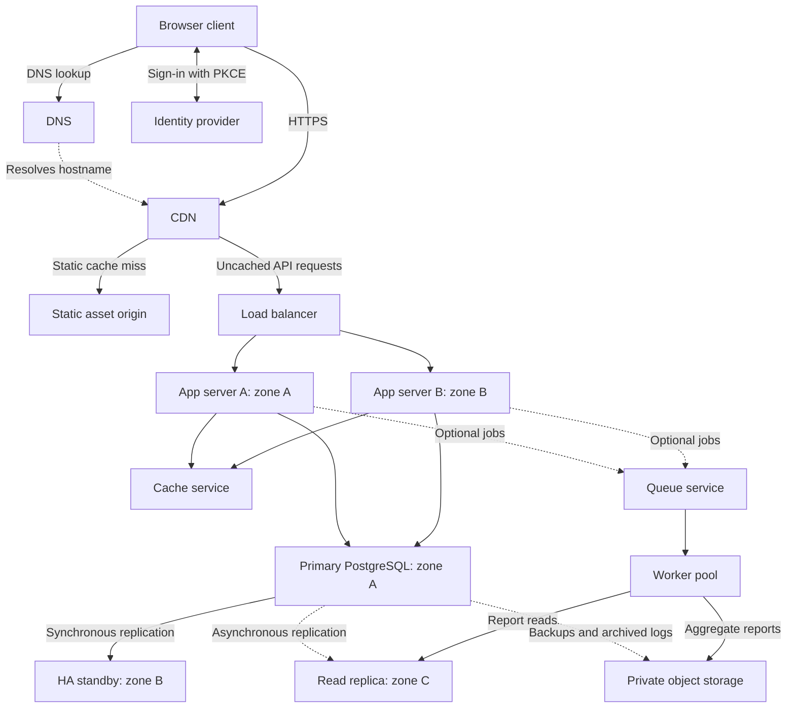

# QuickNotes Architecture

## 1. Purpose and implementation boundary

This document proposes the production service for one million registered
users. It follows [the API design](api-design.md) and
[the data model](data-model.md). The infrastructure described here has not
been deployed or load-tested by this project.

The working assignment client uses plain HTML, CSS, and JavaScript with
JSONPlaceholder's `/posts` endpoints. It demonstrates HTTP GET, POST, DELETE,
validation, safe DOM updates, loading states, and error recovery. Its writes
are simulated; it does not implement authentication, private storage, tags,
or the production components below.

The proposed backend is one modular application deployed on multiple app
servers, with PostgreSQL 18. It uses `/notes`, `/tags`, and `/users/me`, UUID
identifiers, snake_case fields such as `user_id`, and UTC timestamps.

## 2. Functional requirements

- Sign in through the configured OpenID Connect identity provider and read
  the current user's profile using `GET /users/me`.
- Create, list, read, update, and delete owned notes using the endpoints in
  the API design. Note bodies are optional when creating a note.
- Manage owned tags and attach or detach them from owned notes.
- List notes with cursor pagination and an optional owned `tag_id` filter.
- Validate titles, bodies, tags, UUIDs, page limits, and cursors on the server.
- Keep every user's notes and tags private; reject cross-account access.
- Return a creation success only after the note has durably committed.
- Provide consistent JSON errors and predictable empty collection responses.

Sharing, real-time collaboration, attachments, full-text search, and offline
synchronization are outside the initial scope.

## 3. Measurable non-functional requirements

These are proposed acceptance targets, not measurements of this repository.

| Area                       | Target and measurement                                                                                                                                                                                          |
| -------------------------- | --------------------------------------------------------------------------------------------------------------------------------------------------------------------------------------------------------------- |
| Availability               | At least 99.9% monthly availability for authenticated, valid API requests within published quotas. Count service failures and timeouts; a 30-day month permits about 43.2 minutes of unavailability.            |
| Read latency               | `GET /notes` p95 at most 300 ms, measured from API edge arrival to response completion for a default 20-note page with approximately 40 KiB of note content, from the deployment region.                        |
| Write latency              | `POST /notes` p95 at most 500 ms under the same regional load, with a typical 2 KiB note, including durable database commit.                                                                                    |
| Capacity                   | Sustain 250 read requests/second and 100 write requests/second for 30 minutes on a representative year-one dataset, including a run with one app server unavailable.                                            |
| Local recovery             | For a single database node or availability-zone failure: RPO 0 for acknowledged writes and RTO at most 5 minutes, verified by failover drills. RPO measures allowable data loss; RTO measures restoration time. |
| Regional disaster recovery | Target RPO at most 15 minutes and RTO at most 4 hours using cross-region encrypted backups and archived write-ahead logs; verify with quarterly restoration drills.                                             |
| Isolation and security     | HTTPS for all client/API traffic, encrypted database connections and storage, and no successful cross-user access in the authorization test suite for any release.                                              |
| Reporting freshness        | Target replica replay lag below 5 seconds in normal operation; mark reports delayed and pause expensive report jobs if lag exceeds 30 seconds. This does not affect authoritative note reads.                   |

Measure larger pages and maximum-size bodies separately. Monitor p95 latency,
5xx rates, connection usage, database I/O, replica lag, and queue age. These
targets cannot be inferred from the registered-user count alone.

## 4. Load and storage estimates for one million users

### Assumptions

| Assumption                     | Value                                                                                              |
| ------------------------------ | -------------------------------------------------------------------------------------------------- |
| Registered users               | 1,000,000                                                                                          |
| Daily active users             | 20% of registered users: 200,000                                                                   |
| Reads per active user per day  | 10 API requests, including note, tag, and profile reads                                            |
| Writes per active user per day | 4 API requests: one note creation, one edit/delete/tag-management request, and two tag attachments |
| Peak traffic multiplier        | 10 times the full-day average; an estimate to validate against real traffic                        |
| Average new note content       | 2 KiB for title and body together, before row/index overhead                                       |
| New note associations          | Two tags per new note on average                                                                   |
| Average tag inventory          | 10 tags per registered user                                                                        |
| Planning year                  | 365 days; stable daily activity and no pre-existing notes                                          |

These assumptions describe usage for planning, not compulsory behavior or
limits imposed on individual users. Login traffic, static assets, background
jobs, and health checks are additional traffic.

### Average and estimated peak traffic

```text
Daily active users = 1,000,000 × 0.20 = 200,000
Seconds per day = 24 × 60 × 60 = 86,400

Read requests/day = 200,000 × 10 = 2,000,000
Average reads/second = 2,000,000 ÷ 86,400 = 23.15
Estimated peak reads/second = 23.148... × 10 = 231.48

Write requests/day = 200,000 × 4 = 800,000
Average writes/second = 800,000 ÷ 86,400 = 9.26
Estimated peak writes/second = 9.259... × 10 = 92.59
```

The rounded capacity-test target is 250 reads and 100 writes per second.
These are HTTP request rates, not SQL statement rates: authentication includes
a user lookup, and a request can execute multiple statements. Tag attachments
are included in the write count rather than treated as free operations.

### Annual storage growth

Use binary units for assumed record sizes: 1 KiB = 1,024 bytes. Report storage
totals below in decimal GB: 1 GB = 1,000,000,000 bytes.

Ignore note and association deletions when estimating growth, making this
estimate conservative with respect to deletion. Edits replace existing
content; additional write-ahead logs and temporary row versions are excluded
from the live-data total.

```text
New notes/year = 200,000 × 1 × 365 = 73,000,000
Note content/year = 73,000,000 × 2,048 bytes
                  = 149,504,000,000 bytes = 149.504 GB

Allow 50% extra for note rows and indexes:
Indexed note storage/year = 149.504 × 1.50 = 224.256 GB

New associations/year = 73,000,000 × 2 = 146,000,000
Assume 256 bytes per association, including row/index overhead:
Association storage/year = 146,000,000 × 256
                         = 37.376 GB

Annual live-data growth = 224.256 + 37.376 = 261.632 GB

User profiles, including indexes = 1,000,000 × 1,024 bytes = 1.024 GB
Tags, including indexes = 1,000,000 × 10 × 256 bytes = 2.560 GB
Profile/tag baseline = 1.024 + 2.560 = 3.584 GB

Year-one live data per database copy = 261.632 + 3.584
                                    = 265.216 GB, approximately 247.0 GiB

Primary + synchronous standby + reporting replica = three copies
Year-one replicated live data = 265.216 × 3 = 795.648 GB
With a 30% capacity margin above that estimate:
795.648 × 1.30 = 1,034.3424 GB, approximately 1.03 TB across all three copies
```

The profile/tag baseline is not added again every year unless that inventory
grows. Existing data would be additional starting storage. The 50% overhead
and assumed record sizes must be checked with representative PostgreSQL rows
and indexes; they are not measured compression ratios.

Backups, archived logs, database bloat, cache memory, and report files need
separate capacity budgets. The 30% margin is a starting provision allowance,
not proof that every operational overhead is covered. Recalculate if average
note sizes or activity increase and alert before storage becomes exhausted.

## 5. Architecture diagram



DNS resolves names; it does not forward HTTP requests. The CDN serves public
static assets and forwards API requests without caching their private
responses. The illustration shows logical services: the DNS, CDN, load
balancer, cache, queue, and object storage must use redundant managed service
deployments rather than individual machines. The worker pool has at least two
instances across zones.

### Component responsibilities

| Component              | Problem it solves                                                                                                                                     |
| ---------------------- | ----------------------------------------------------------------------------------------------------------------------------------------------------- |
| Browser client         | Presents notes and forms, sends requests, renders text safely, and gives accessible loading, success, and error feedback.                             |
| DNS                    | Resolves service hostnames to the public entry point without tying clients to individual app-server addresses.                                        |
| CDN                    | Delivers public HTML, CSS, and JavaScript close to users and reduces static-file requests to the origin.                                              |
| Static asset origin    | Stores deployable client files so a CDN cache miss does not depend on one app server's local disk.                                                    |
| Load balancer          | Distributes API requests across healthy app instances and removes failed instances from rotation.                                                     |
| App servers A and B    | Run the same stateless application, enforcing authentication, validation, ownership, and HTTP response rules while tolerating one instance's failure. |
| Identity provider      | Handles sign-in and credentials, issuing access tokens the API can verify without storing passwords in QuickNotes tables.                             |
| Cache service          | Shares trusted public signing-key caches and approximate per-user rate counters, reducing repeated provider lookups and coordinating request limits.  |
| Primary database       | Durably stores the four relational tables and serves authoritative user-facing queries and writes.                                                    |
| Synchronous HA standby | Holds a durable copy of acknowledged writes in another zone and can replace a failed primary.                                                         |
| Read replica           | Separates lag-tolerant operational reporting from the primary's interactive workload.                                                                 |
| Queue                  | Buffers optional report and analytics work so slow background processing does not delay saving a note.                                                |
| Worker pool            | Processes queued jobs independently of API instances and can scale or restart without interrupting note requests.                                     |
| Private object storage | Retains encrypted backups, archived logs, and internal report outputs independently of database or worker disks.                                      |

Public client assets and private backups/reports use separate buckets and
access policies. Reports are operational outputs, not additional public API
features. Database, cache, and queue connections stay on private networks.

## 6. GET /notes request flow

1. The browser resolves the hostname if needed and sends
   `GET /notes?limit=20` with a bearer access token over HTTPS. The CDN bypasses
   API response caching and forwards the request to the load balancer.
2. The load balancer chooses a healthy app server. The server creates a request
   ID and verifies the token's signature, allowed algorithm, configured issuer,
   audience, expiry, and subject. Trusted signing keys may be read from cache;
   an ID token is not accepted as an API access token.
3. The server maps the verified subject to `users.auth_subject` on the primary
   database and checks `notes:read`. Missing/invalid authentication gives `401`;
   insufficient scope gives `403`. A supplied client owner ID is never trusted.
4. Apply the per-user request limit and validate the query. `limit` defaults
   to 20 and must be 1–100. Verify any cursor's signature, owner, collection,
   and filters. Validate `tag_id` and check that the tag belongs to the user;
   an inaccessible tag gives `404`.
5. Query the primary with the authenticated `user_id`, ordered by
   `created_at DESC, id DESC`, using the documented indexes and parameterized
   SQL. For later pages, seek after the cursor's timestamp/UUID pair. Retrieve
   `limit + 1` rows to detect another page. A tag filter joins owned associations.
6. Return `200` with `data` and `pagination`, at most `limit` notes, and a signed
   next cursor or `null`. No matching notes is a successful empty collection.
   Set `Cache-Control: private, no-store`. Do not use the reporting replica or
   a private-note cache for this response.
7. The production client checks the HTTP status, renders title/body using
   `textContent`, and announces success or an empty state. Errors use the API's
   JSON error format; the client preserves its current notes on failure.

The initial API does not promise a snapshot across multiple pages. Concurrent
inserts appear on a fresh first page; deletions and tag changes can affect
later pages, as described in the API design.

## 7. POST /notes request flow

1. The browser sends `POST /notes` with a bearer access token and JSON
   `{ "title": "Prepare presentation", "body": "Review the diagrams." }`.
   It disables duplicate submissions while the request is in progress.
2. The CDN forwards the uncached request through the load balancer. The app
   verifies authentication, resolves the local user, checks `notes:write`, and
   applies request limits as in the GET flow.
3. Validate JSON and content type, enforce the 256 KiB request-body limit,
   and reject unknown/read-only fields. Trim the title and require 1–100
   characters; reject whitespace-only titles. The optional body defaults to
   `""` and must have at most 10,000 characters. Clients cannot set `user_id`.
4. Start a short primary-database transaction. Insert the note with the
   authenticated owner. PostgreSQL generates its UUID and initial timestamps;
   constraints also validate lengths, ownership references, and required data.
5. Commit with `synchronous_commit = on` and a configured synchronous standby.
   Wait for durable write-ahead-log storage on the primary and the required
   standby before treating the note as successfully created. Keep crash-safe
   WAL settings, including `fsync` and `full_page_writes`, enabled; do not lower
   transaction durability for note writes.
6. After successful commit, return `201 Created`, `Location: /notes/{note_id}`,
   the complete note object, and `Cache-Control: private, no-store`. Neither
   queue publication nor report generation determines this success.
7. Schedule optional background analytics after commit using a bounded,
   best-effort dispatch path. A dispatch failure is logged and does not change
   the creation response or roll back the already-committed note.
8. On a confirmed success, the production client prepends the returned note
   and clears the form. On failure, it preserves unsaved input and restores
   controls. Unexpected errors return a safe `500`; temporary dependency
   outages may return `503` with `Retry-After` when known.

If the connection fails after commit, the note might exist even though the
client received no success. POST is not idempotent in the initial API: inspect
the list before a manual retry and do not automatically repeat creation.
An idempotency-key extension would require an additional documented contract
and durable deduplication storage; it is not implemented by this design.

## 8. Synchronous work and queue work

Authentication, ownership checks, validation, core note/tag changes, and their
database commits happen synchronously. DELETE cascades association removal in
the same transaction. The app explicitly updates `updated_at` on content
changes and tag renames; insert defaults do not update it automatically.

The queue holds periodic aggregate-report jobs and optional coarse analytics
events. Event payloads contain an opaque event ID, event type, and timestamp;
they omit bearer tokens, titles, and bodies. Workers use the reporting replica
for lag-tolerant reports and write results to private storage.

Use at-least-once queue delivery with bounded retries, a visibility timeout,
and a dead-letter queue for repeated failures. Make report jobs idempotent:
write a deterministic report-window object instead of appending another copy
on retry. Deduplicate optional analytics by event ID where practical; these
metrics are approximate and are not an audit ledger or source of note data.

An app crash between database commit and job publication can lose an optional
event. That is an accepted trade-off for this initial service. If an event
later becomes essential, add a transactional outbox and durable consumer
deduplication through a reviewed schema/API design change. Do not claim that
the existing four tables already provide exactly-once event processing.

## 9. Consistency, caching, and user isolation

### Replica lag

User-facing note reads and ownership checks use the primary, providing
read-your-writes after successful mutations. The reporting replica may not
yet contain a new note or deletion. Reports show their data timestamp; workers
monitor replay lag and defer reports when it exceeds the stated threshold.
Never use a stale report result to decide whether a write succeeded or to
authorize a request.

### Cache invalidation

Private notes are not cached initially, so note creation, edits, and deletes
cannot leave stale note objects in a cache. Their HTTP responses remain
`private, no-store`, including at the CDN.

Cache trusted provider signing keys with a bounded TTL, refresh according to
the provider's rotation policy, and invalidate both shared and local entries
during an urgent key-revocation response. An unknown key ID triggers a bounded,
rate-limited refresh from the configured provider, never an arbitrary URL from
the token. If verification cannot be completed safely, fail closed.

Rate-counter keys include the authenticated user UUID and time window and
expire after that window. Counters can be approximate after cache failover;
they are not billing or authorization records. During cache outages, use
conservative per-instance limits and edge protection rather than losing notes.

For public static files, version assets during deployments, use long caching
for immutable versions, and short caching for HTML. If private-note caching
is introduced later, design owner-scoped keys and commit-time invalidation
for item, list, and tag-filter entries, including races between fills and
invalidations, before enabling it.

### User data isolation

Every user-facing SELECT, UPDATE, and DELETE includes the verified `user_id`.
Missing or other-owned resources return the same `404`; insufficient endpoint
scope returns `403`. The composite foreign keys in `note_tags` additionally
prevent cross-owner associations, but do not replace authentication.

Use parameterized SQL, restricted service roles, encrypted connections, and
separate worker/database credentials. Only authorized operational workers may
read cross-user data for internal aggregates; their outputs are private.
Never log bearer tokens or note content. The initial schema relies on scoped
backend queries; PostgreSQL row-level security is a possible later defense,
not a policy already present in the supplied CREATE TABLE statements.

## 10. Trade-offs and workload justification

| Decision                                                   | Benefit                                                                                               | Cost or limitation                                                                                                       |
| ---------------------------------------------------------- | ----------------------------------------------------------------------------------------------------- | ------------------------------------------------------------------------------------------------------------------------ |
| One modular backend with multiple instances                | Keeps HTTP, validation, and transaction logic understandable and allows independent instance scaling. | Requires clear module boundaries; individual features cannot be deployed as independently as separate services.          |
| Primary reads rather than replica/private-note cache reads | Preserves immediate note visibility and simplifies ownership, deletion, and invalidation behavior.    | Concentrates interactive database load on the primary; scale and optimize it before moving selected reads elsewhere.     |
| Synchronous standby for durable writes                     | Protects acknowledged notes against one node or zone failure.                                         | Adds network/flush latency and can temporarily block writes when no eligible standby is available.                       |
| Best-effort optional events instead of an outbox           | Keeps the initial four-table design small and note creation independent of queue availability.        | Some analytics events can be lost; reliable event-driven business workflows would need more schema and processing logic. |

The estimated peak is about 324 API requests per second. It justifies starting
with two appropriately sized app instances and one indexed primary database,
subject to load testing. The annual data growth makes storage planning and
query measurement important even though average request rates are modest.

The reporting replica, queue, and workers satisfy the assignment's topology
and isolate optional operational work; they are not required to make a basic
note INSERT succeed. At a smaller scale they could be deferred. The cache is
used for shared keys/counters rather than speculative note caching. Managed
services reduce infrastructure work, but still add cost, credentials,
monitoring, configuration, and failure modes. No sharding, microservices, or
active-active multi-region writes are justified by these assumptions alone.

## 11. Failure handling and avoiding single points of failure

| Failure area                          | Redundancy and recovery approach                                                                                                                                                |
| ------------------------------------- | ------------------------------------------------------------------------------------------------------------------------------------------------------------------------------- |
| DNS, CDN, load balancer, asset origin | Use managed redundant services and durable object storage rather than one gateway or local static-file disk.                                                                    |
| App instance or zone                  | Keep at least two instances across zones, use health checks and connection draining, and size the remaining capacity for the peak target.                                       |
| Database primary                      | Maintain a cross-zone synchronous standby, a stable writer endpoint, automated failover, and fencing of the old primary.                                                        |
| Synchronous standby                   | Configure the reporting replica as an eligible fallback; it must catch up before acknowledging new synchronous commits. Pause writes rather than silently weakening durability. |
| Cache                                 | Use a replicated managed deployment; retain bounded local trusted-key caches and conservative request-limit fallback. Note storage does not depend on cached note objects.      |
| Queue or worker                       | Use a redundant durable queue and at least two worker instances; optional jobs can wait or fail without blocking core note requests.                                            |
| Region or destructive data change     | Keep encrypted cross-region backups and archived logs for 30 days, with quarterly point-in-time restoration drills. Replicas alone do not undo accidental deletion.             |

### Database failover sequence

1. The managed failover controller detects the unhealthy primary and obtains
   leadership through a quorum spanning failure domains.
2. Fence the old primary so it cannot keep accepting writes after a partition;
   a health-check failure alone is not enough to prevent two writers.
3. Promote a standby known to contain all acknowledged commits. Normal
   operation uses `synchronous_commit = on` and a priority configuration such
   as `FIRST 1 (ha_standby, report_replica)`: the HA standby is normally
   synchronous and the reporting replica is normally asynchronous.
4. Redirect the writer endpoint, discard broken pooled connections, and
   reconnect app servers. Re-establish synchronous protection with an eligible
   caught-up standby before acknowledging new writes under the RPO 0 policy.
5. Rebuild or rejoin the failed node as a replica and verify replication and
   data integrity. Until service recovers, return safe temporary errors.

Do not blindly promote the reporting replica just because it is reachable;
its normal asynchronous role may be behind. Test the manager's promotion
policy and the RTO target. Cross-zone replication protects a single-zone
failure; it does not promise zero loss after an entire-region disaster.

The identity provider is an external dependency. Existing tokens can be
verified while trusted keys remain valid and available; new sign-ins can fail
during a provider outage. Managed redundancy reduces individual-machine
failure risk, but does not eliminate provider-wide or regional outages.

## 12. Delivery and operational practices

Keep client and design changes in meaningful Git commits. The future backend
uses reviewed changes and automated checks for validation, ownership,
transactions, and HTTP contracts. Test cross-account attempts and failed
operations, not only successful requests.

Deploy app instances gradually with health checks and rollback capability.
Use versioned, backward-compatible database migrations and keep transactions
short. Bound connection pools across all app/worker instances so scaling the
application does not exhaust PostgreSQL's connection budget.

Alert on service errors, latency, low disk space, pool exhaustion, synchronous
replication health, replay lag, failed backup uploads, queue age, and dead-letter
jobs. Load tests, failover drills, and backup restorations must establish the
targets before production readiness is claimed. The browser demo alone cannot
verify this production architecture.

## 13. Technical references

- [PostgreSQL standby servers and synchronous replication](https://www.postgresql.org/docs/18/warm-standby.html)
- [PostgreSQL write-ahead-log durability settings](https://www.postgresql.org/docs/18/runtime-config-wal.html)
- [PostgreSQL continuous archiving and point-in-time recovery](https://www.postgresql.org/docs/18/continuous-archiving.html)
- [HTTP caching: RFC 9111](https://www.rfc-editor.org/rfc/rfc9111.html)
- [Example of at-least-once delivery semantics: Amazon SQS](https://docs.aws.amazon.com/AWSSimpleQueueService/latest/SQSDeveloperGuide/standard-queues-at-least-once-delivery.html)
